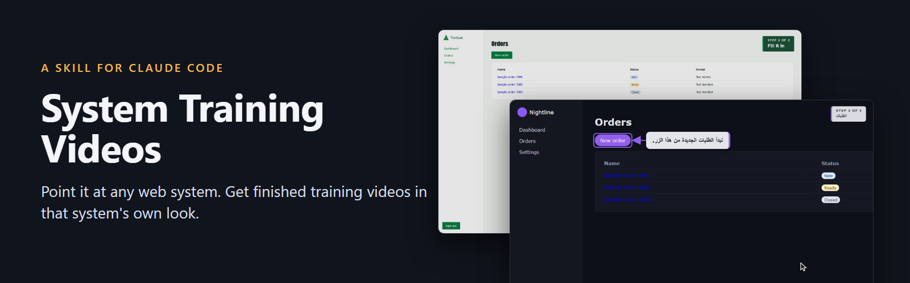
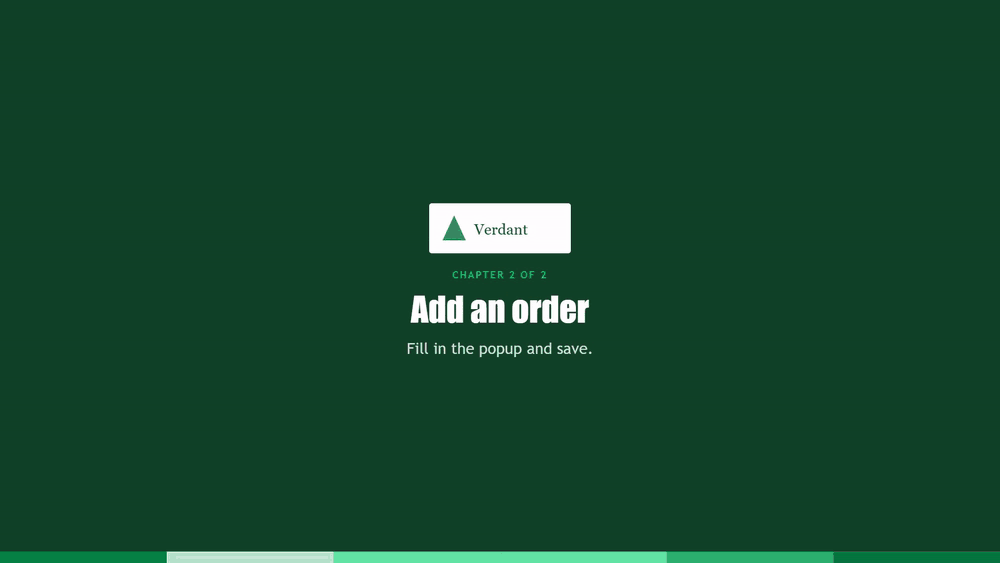
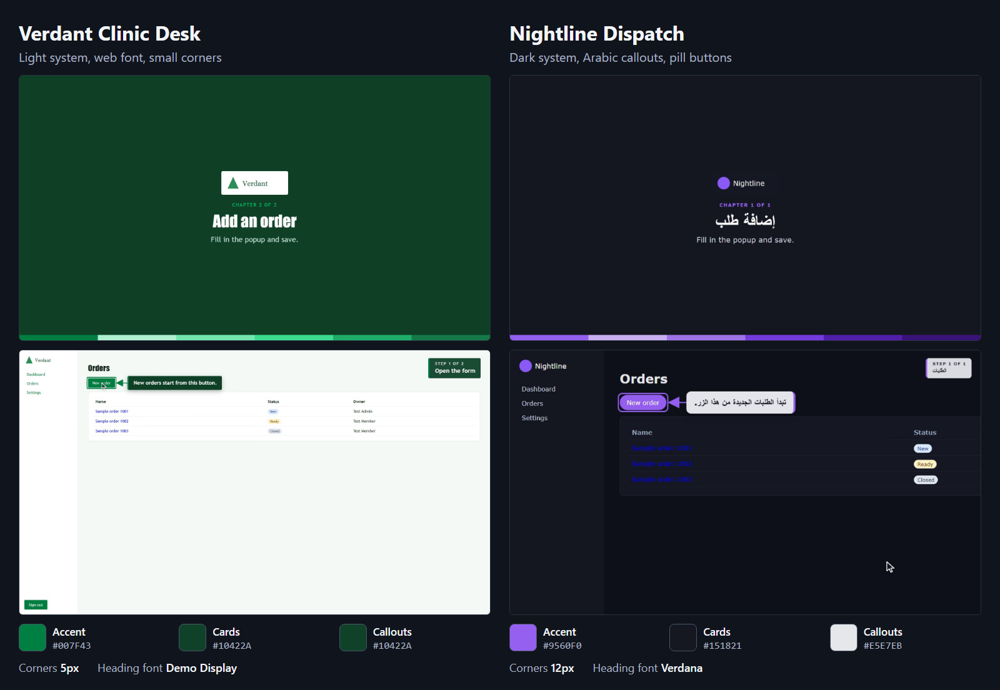
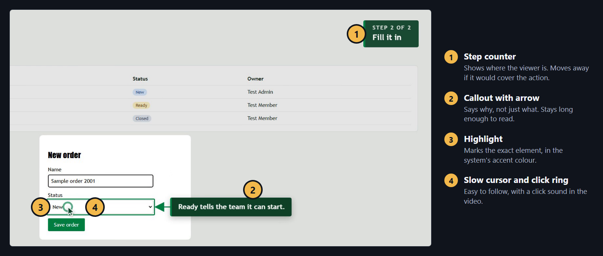
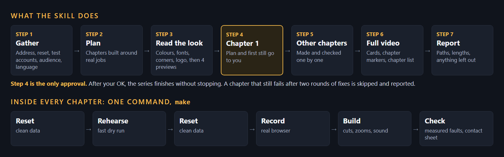
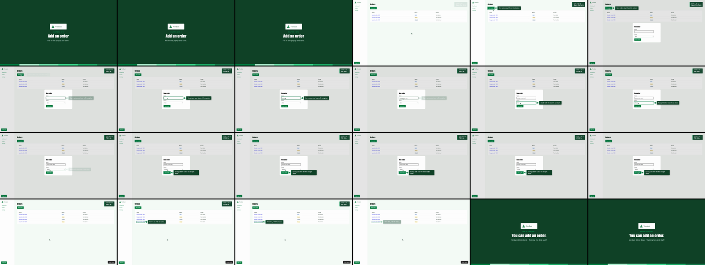

<p align="center">
  
</p>

# System Training Videos

**A [Claude Code](https://claude.com/claude-code) skill that turns any running web system into a finished series of training videos, in that system's own look.**


Say *"make training videos for this system"*. Claude learns the system, plans the chapters, reads its colours, fonts and logo, records real use in a browser, edits the footage, adds sound effects and checks the result.

You get one short video per chapter, plus one full video with chapter markers.

<p align="center">
  
</p>
<p align="center"><em>Two fictional demo systems, one layout. This animation is silent, but the real videos have sound.</em></p>

**Watch the samples, with sound:** [full video with chapter markers](docs/media/sample-full-video.mp4) (0:56) · [dark system with Arabic callouts](docs/media/sample-arabic-dark.mp4) (0:14)

## Contents

- [Why use it](#why-use-it)
- [One layout, each system's own look](#one-layout-each-systems-own-look)
- [What is on the screen](#what-is-on-the-screen)
- [How it works](#how-it-works)
- [Install](#install)
- [Use it](#use-it)
- [What you get](#what-you-get)
- [Commands](#commands)
- [Write a chapter](#write-a-chapter)
- [Built-in quality checks](#built-in-quality-checks)
- [Safety rules](#safety-rules)
- [What has been tested](#what-has-been-tested)
- [What is in this repository](#what-is-in-this-repository)

## Why use it

Training videos usually cost days of recording, and they go out of date with the next redesign. This skill makes them repeatable.

| The usual problem | What this skill does |
|---|---|
| Recording by hand takes many attempts | A script drives the browser, so every take is clean and can be run again |
| Viewers sit through loading screens | The screen is frozen during a wait, and the wait is cut out |
| Videos look unlike the product | Colours, fonts, corners and logo are read from the running system |
| A redesign makes every video old | Run `brand` again and re-make the chapters |
| Recording leaves test data behind | Test data is reset before every recording |
| Mistakes are found after publishing | Each chapter gets automatic checks and a contact sheet |

The method comes from a real series of 11 chapters and 16 minutes. This skill is the general version of that work, and each rule in it answers a problem that really happened.

## One layout, each system's own look

The layout stays the same. Everything that makes a system recognisable comes from the system.

<p align="center">
  
</p>

| Same in every system | Read from the system |
|---|---|
| 1920 × 1080 MP4 at 30 frames a second | Card and callout colours |
| Title card with logo, title, one line and colour band | Highlight, arrow and click-ring colour |
| Callout with arrow, and a highlight on the element | Heading and body fonts, including web fonts |
| "Step n of N" counter | Corner roundness, from its buttons |
| Slow cursor, click rings, smooth zooms | Logo |
| Jump cuts over loading | Light or dark callouts, by its background |
| Sound effects, made in code | Language, and right-to-left text |
| Black chapter cards and chapter markers | |

Colour detection is a strong first guess, not a fact. It handles `oklch`, `lab`, `hsl` and shadcn-style variables, and adjusts pairs that would be hard to read. You check four preview pictures before anything is recorded, and any value can be overridden in the settings.

## What is on the screen

<p align="center">
  
</p>

There is no voice-over. Short callouts sit next to the element they explain, and each one says why it matters, not only what it is.

Sound effects are generated in code, so there are no audio files to license. They cover clicks, typing, zoom whooshes, callout pops and scroll swishes.

## How it works

<p align="center">
  
</p>

## Install

You need:

- [Claude Code](https://claude.com/claude-code)
- [Node.js](https://nodejs.org) 18 or newer
- [ffmpeg](https://ffmpeg.org), including `ffprobe`
- A copy of your system running locally, with test accounts and fictional data

Install ffmpeg:

```bash
winget install ffmpeg      # Windows
brew install ffmpeg        # macOS
sudo apt install ffmpeg    # Debian or Ubuntu
```

Then clone this repository into your Claude Code skills folder. The folder name must stay `system-training-videos`.

**Windows (PowerShell)**

```powershell
git clone https://github.com/omar520/system-training-videos.git "$HOME\.claude\skills\system-training-videos"
```

**macOS or Linux**

```bash
git clone https://github.com/omar520/system-training-videos.git ~/.claude/skills/system-training-videos
```

The skill is now available in every project on that computer. Restart Claude Code if it was already open.

To update later, run `git pull` inside that folder.

## Use it

Open Claude Code in your system's project folder, then type the skill's name:

```text
/system-training-videos
```

Or just ask in your own words:

```text
Make training videos for this system.
Record a walkthrough of how a new staff member uses this portal.
فيديوهات تدريب للنظام
```

Claude looks through the project first, then asks once for anything still missing:

1. How to start the system locally, and its address
2. How to reset the test data
3. Test accounts, one for each role
4. Who the videos are for
5. The language of the callouts
6. Where to save the videos

It then shows you the chapter plan and the first still. **That is the one approval.** After your OK, it finishes the series and reports back, including anything it left out and why.

## What you get

Everything is written to a folder outside your repository, so videos are never committed by accident.

```text
my-system videos/
├── my-system-training.mp4      the full video, with chapter markers
├── chapters.txt                "00:00 Title" lines, ready for YouTube
├── chapters/
│   ├── 01-getting-started.mp4
│   └── 02-new-order.mp4
├── stills/                     one picture per chapter
└── _work/                      previews, contact sheets and working files
```

Your project gains one folder with its own packages. Your application's code and dependencies are not changed.

```text
my-system/
└── video-tour/
    ├── tour.config.mjs         address, accounts, reset, corrections to the look
    ├── tour.mjs                the one command
    ├── theme.json              the look that was read from the system
    ├── theme-logo.png
    ├── chapters/               one small script per chapter
    └── engine/                 a copy, so the project can re-make videos without the skill
```

## Commands

Claude runs these for you. You can also run them yourself from the project folder, because the engine is plain Node once set up.

| Command | What it does |
|---|---|
| `node video-tour/tour.mjs brand` | Reads the system's look and saves four previews |
| `node video-tour/tour.mjs make 3` | Rehearses, records, builds and checks chapter 3 |
| `node video-tour/tour.mjs record 3` | Records chapter 3. Add `--rehearsal` for a fast dry run, or `--no-reset` to skip the data reset |
| `node video-tour/tour.mjs build 3` | Applies cuts, zooms, the counter and sound |
| `node video-tour/tour.mjs check 3` | Runs the checks and makes a contact sheet and a still |
| `node video-tour/tour.mjs join` | Makes the full video, chapter markers and `chapters.txt` |

## Write a chapter

A chapter is one short script, and it reads like the steps of the job:

```js
export const meta = {
  title: "Reports",
  line: "See this month's numbers.",
  endTitle: "You can read your reports.",
};

export async function run(d, { page }) {
  await d.start();
  await d.step(1, 1, "Open the report");

  const link = page.getByRole("link", { name: "Reports" });
  await d.say("Reports show this month's numbers.", link, { side: "right" });
  await d.click(link, { after: 0 });
  await d.loaded(page.getByRole("heading", { level: 1, name: "Reports" }), 700);

  await d.end();
}
```

Every action and pattern is in [`references/writing-chapters.md`](references/writing-chapters.md). Settings and look corrections are in [`references/theme-and-config.md`](references/theme-and-config.md). Known problems and their fixes are in [`references/troubleshooting.md`](references/troubleshooting.md).

## Built-in quality checks

`check` runs on every chapter and stops on a serious fault. It measures:

- callouts on screen for under 2.5 seconds
- loading screens that reached the final video
- browser errors during recording
- sound levels

It also makes a contact sheet, so a whole chapter can be read at a glance. Claude reads these frames for what a measurement can't see: a callout on the wrong element, an error message, or something covering the action.

<p align="center">
  
</p>

## Safety rules

The scripts click and save for real, and a video can be shared with anyone. So:

- **Local copy only by default.** Non-local addresses are refused. Only a system's owner should set `allowRemote: true`, and only for a test server with fictional data.
- **Fictional data only.** Never record real people's names, emails or documents. Upload steps use a generated silhouette and generated PDFs.
- **Your application is not changed.** If a job can't be shown without changing the app, it is left out and reported.
- **Nothing is faked.** A job that needs an outside service, or gives changing answers, is left out and reported.
- **Project rules come first.** Claude reads the project's own instructions, such as a `CLAUDE.md`, and follows them.

## What has been tested

Tested on Windows 11. The demo systems are fictional and were made only for testing.

| Test | Result |
|---|---|
| Light system: full page reloads, `oklch` colours, web font, logo | Passed: look, two chapters, full video with chapter markers |
| Dark system: Arabic callouts, pill buttons | Passed: look and one chapter |
| Reading the look of a large real Next.js system, with no custom code | Passed |
| A chapter with a loading screen left in on purpose | Caught by `check` |
| A non-local address | Refused |

Not proven yet:

- **Recording a single-page app.** A system that changes pages without reloading has not been fully recorded with this general version. The recording of the real Next.js system above did not finish.
- **Some chapter actions** have not been run in this version: `switchUser`, `choose`, `upload`, `navAction`, `saved`, `fill`, and `loaded` with `sameUrl`.
- **macOS and Linux.**
- **Sound by ear.** Levels are measured, not listened to. Listen to one chapter before you share a series.

It isn't for editing existing footage, marketing promos or desktop apps.

## What is in this repository

```text
system-training-videos/
├── SKILL.md         instructions Claude follows
├── engine/          recording, editing, sound, theme reading and checks
├── references/      how to write chapters, settings, troubleshooting
├── scripts/         init.mjs, which sets up video-tour/ in a project
├── template/        starting files for a new project
└── docs/media/      the pictures and samples on this page
```
